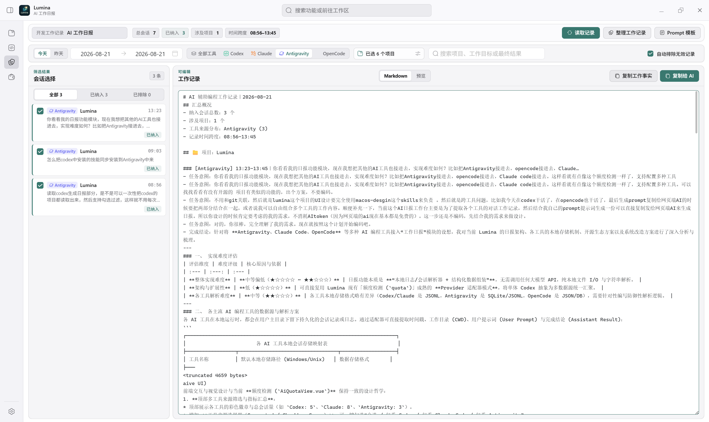
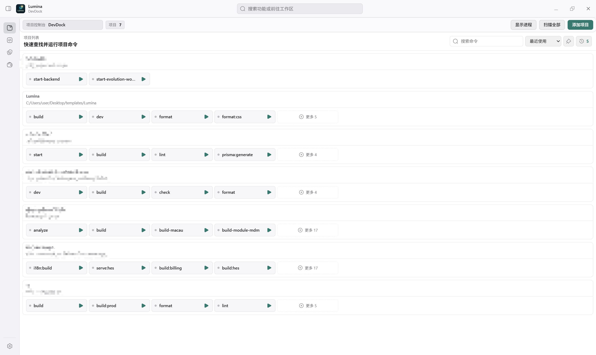
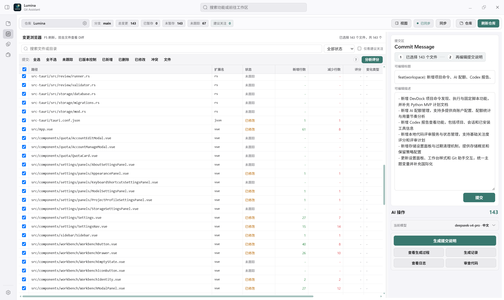

<div align="center">
  

  # Halowake

  **A Local-First Developer Workbench for AI Coding**

  Codex, Claude Code, Antigravity, and OpenCode write the code.  
  **Halowake handles everything around it: aggregating sessions, launching services, managing Git and skills.**

  [](https://github.com/zhkai-ybwn/Halowake/releases/latest)
  [](LICENSE)
  [](https://github.com/zhkai-ybwn/Halowake/releases/latest)
  [](https://v2.tauri.app/)

  **[Download Releases](https://github.com/zhkai-ybwn/Halowake/releases/latest)** · **[Quick Start](#-get-started-in-3-minutes)** · **[Feature Overview](#-what-can-you-do-with-halowake)** · **[Feedback & Issues](https://github.com/zhkai-ybwn/Halowake/issues/new/choose)**

  [简体中文](README.md) · [English](README.en.md)
</div>

---

## What's new in v1.5.0

This release removes the Token Wallet (AI Quota Center), Codex quota warmup, and built-in code review. Halowake focuses on work records, project services, Git commits, and Skills management.

Git Assistant supports diff viewing, file selection, commit message generation, and committing selected files. Previously configured Codex warmup schedules stop running after upgrading. Legacy quota accounts and review history stay in the local database, with expired, unpinned review records following the existing cleanup policy.

This release also improves repeated session loading, on-demand page loading, background polling, and large diffs. [Read the full release notes](docs/releases/v1.5.0.md)

<p align="center">
  
  <sub>A real-world use case: Extracting work facts from local agent sessions, selecting records, and copying them to an AI for daily standup reports.</sub>
</p>

## Why Halowake?

When working with multiple AI coding agents, writing code is only part of the job:

- Before finishing work, sifting through different agent logs to piece together what was accomplished today.
- Maintaining multiple projects at once, switching between terminals, starting services, and tracking down occupied ports.
- The agent modified dozens of files, but before committing you still need to review diffs, pick files, and craft commit messages.
- Skills are scattered across multiple tools and folders, making them hard to find and manage.

**Halowake does not provide another code-generation agent, nor does it replace your IDE.** It is a desktop app running locally on your machine that brings these repetitive, fragmented developer tasks together into one place.

## ✨ What Can You Do with Halowake?

### 1. Bring work records from multiple coding agents together

No need to scroll through chat history one by one. Halowake directly parses locally saved sessions from **Codex CLI, Claude Code, Google Antigravity, and OpenCode**, filtering by date, project, tool, and keyword, letting you select records to produce an editable summary of work facts.

- **Local extraction, 0 extra API tokens**: Scanning, parsing, and structuring raw sessions does not call any LLM.
- **Human-inspectable results**: Exclude noisy sessions, selectively include items, and edit Markdown.
- **One-click copy to AI**: Copy work facts together with standup/weekly prompt templates, then feed them to your preferred AI to generate final summaries.

> **Note**: "0 Token" refers to **local session extraction and work fact aggregation**; when copying content to an external AI to generate final reports, billing depends on the service you use.

### 2. DevDock: Manage developer services across multiple projects

No need to remember which terminal launched which service, or repeatedly hunt down processes hogging ports.

- Discovers runnable commands from `package.json`, common Python entry points, and project scripts.
- Start, stop, and restart multiple project services in a single dashboard while monitoring output logs.
- Sniffs service ports and localhost URLs from logs to open pages with one click.
- Troubleshoot port conflicts, identify culprit processes, and terminate them after confirmation.

<p align="center">
  
</p>

### 3. Git Assistant: Maintain full control before committing

After an AI generates code, you still decide **which files belong in the commit**.

- Inspect workspace status and Working Tree / Staged / HEAD diffs.
- Selectively commit specified files; stages selected files while preserving and restoring the original index state of unselected files to reduce accidental commit risks.
- Analyze diffs and generate Conventional Commit messages using your configured Ollama or OpenAI-compatible model.
- Browse commit history and branches, executing common Git operations like Pull, Push, Merge, Rebase.

<p align="center">
  
</p>

### 4. Skills Center: Discover, install, and manage Agent Skills

Unified view for installed skills across Codex, Claude Code, Antigravity, and OpenCode, with discovery and selection from an online catalog.

- Fast search across synced skills using local SQLite FTS5; supports filtering and sorting.
- Inspect skill sources and documentation; install to the **current project, a specific agent, or global directories**.
- Check for updates, inspect installation history, and uninstall safely; detects local modifications to prevent silent overwrites.
- Online catalog is sourced from the independent [Halowake Skills Registry](https://github.com/zhkai-ybwn/halowake-skills-registry) (requires network connection to sync).

> Skills are external code and instructions. Inspect sources and `SKILL.md` before installing; never execute untrusted scripts in untrusted repositories.

### Additional handy tools

| Feature | Purpose |
| --- | --- |
| **Agent Storage** | Inspect disk space across multiple agents and safely clean clearly listed caches |
| **Markdown Workbench** | Markdown preview, syntax highlighting, document outline (TOC), and detached window reading |
| **Desktop Experience** | Dark / Light theme, English & Chinese interface, system tray, and in-app update checks |

## 🚀 Get Started in 3 Minutes

### 1. Install

Head to **[GitHub Releases to download the latest version](https://github.com/zhkai-ybwn/Halowake/releases/latest)**, choosing the installer for your operating system.

| Operating System | Release Artifact |
| --- | --- |
| **Windows x64** | `Halowake_<version>_x64-setup.exe` |
| **macOS (Intel / Apple Silicon)** | `Halowake_<version>_universal.dmg` |
| **Linux (Debian / Ubuntu family)** | `Halowake_<version>_amd64.deb` |
| **Linux (AppImage)** | `Halowake_<version>_amd64.AppImage` |

> Download the installer for your operating system from the release assets listed above.

### 2. Open Your Project

Launch Halowake, then add or select a local project directory. You can start by checking detected project scripts in **DevDock**, or head to **Git Assistant** to inspect your repository status.

### 3. Start with a Scenario

- **Prepare a standup report**: Open "Session History", pick a date and Agent → load sessions → check relevant records → generate and copy.
- **Manage project services**: Open "DevDock" → select project scripts → start services → monitor logs and ports.
- **Safely commit changes**: Open "Git Assistant" → inspect diffs → select files → edit / generate commit message → commit.

## 🔒 Local-First & Data Boundaries

Project scanning, Git operations, session parsing, report aggregation, and local state run on your machine without relying on Halowake-hosted cloud services.

However, **Local-first does not mean every feature is completely offline**:

- **AI commit messages**: When using online models, the necessary prompts and selected diffs are sent to your configured provider; choosing local Ollama runs supported models on your device.
- **Skills registry sync & installation**: Downloads data from configured remote registries and skill repositories.
- **Credentials**: Uses local configuration and persistence; Windows protects certain keys via DPAPI. Protect your local accounts and never expose sensitive configurations or logs publicly.

**Always verify target repositories, processes, or directories before executing Git writes, process termination, or cache cleanup.**

## 🛠️ Run from Source

The development environment requires **Node.js 20+, Rust 1.77.2+, Git**, and OS-specific [Tauri 2 prerequisites](https://v2.tauri.app/start/prerequisites/).

```bash
git clone https://github.com/zhkai-ybwn/Halowake.git
cd Halowake
npm ci
npm run tauri:dev
```

Build production installer:

```bash
npm run tauri:build
```

Before submitting changes, you can run:

```bash
npm run lint
npm run test:unit
cargo test --manifest-path src-tauri/Cargo.toml --lib
cargo test --manifest-path src-tauri/Cargo.toml --test skill_registry_search
```

**Tech Stack**: Tauri 2 · Rust · Vue 3 · TypeScript · Vite · Naive UI · Pinia · SQLite (WAL / FTS5)

## 🤝 Community & Contributing

Halowake is continuously evolving. The most helpful contribution is **real-world usage feedback**: which agent you use, which OS, which step in your workflow takes the most time, and which feature did not meet expectations.

- [Report a Bug / Request a Feature](https://github.com/zhkai-ybwn/Halowake/issues/new/choose)
- [View Contributing Guide](CONTRIBUTING.md)
- [View Releases & Downloads](https://github.com/zhkai-ybwn/Halowake/releases)

If Halowake helps your daily workflow, please consider giving the repository a **Star** so more developers can discover it.

## 📄 License

[MIT](LICENSE) © Halowake contributors
