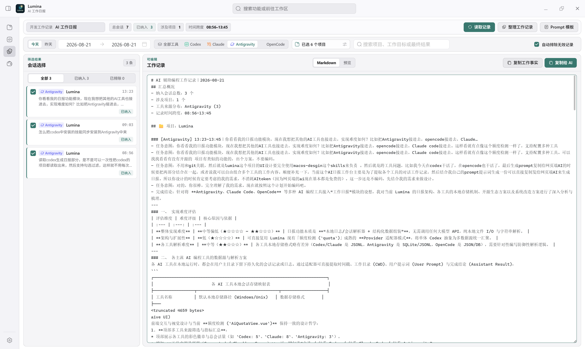
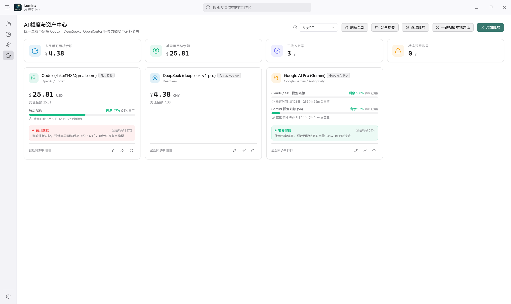
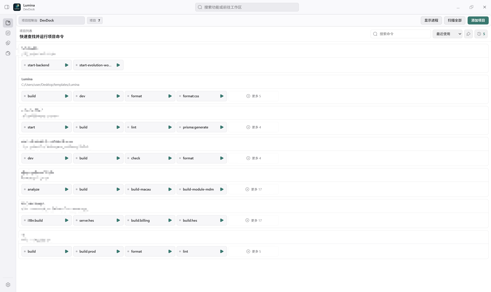
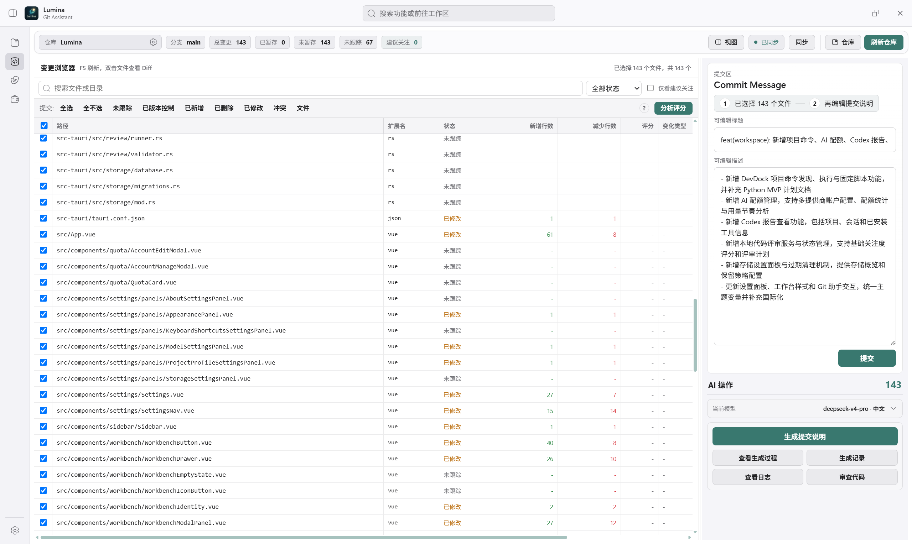

 
<div align="center">
  

  # Halowake

  **AI Coding 的本地开发工作台**

  Codex、Claude Code、Antigravity 和 OpenCode 负责写代码。  
  **Halowake 帮你处理代码之外的工作：整理会话、启动项目、管理 Git、Skills 与 AI 额度。**

  [](https://github.com/zhkai-ybwn/Halowake/releases/latest)
  [](LICENSE)
  [](https://github.com/zhkai-ybwn/Halowake/releases/latest)
  [](https://v2.tauri.app/)

  **[下载安装](https://github.com/zhkai-ybwn/Halowake/releases/latest)** · **[快速上手](#-3-分钟开始使用)** · **[功能一览](#-你可以用-halowake-做什么)** · **[反馈问题](https://github.com/zhkai-ybwn/Halowake/issues/new/choose)**

  [简体中文](README.md) · [English](README.en.md)
</div>

---

<p align="center">
  
  <sub>一个真实的使用场景：从本地 Agent 会话提取工作记录，筛选后复制给 AI 整理日报。</sub>
</p>

## 为什么做 Halowake？

使用多个 AI Coding Agent 时，写代码只是工作的一部分：

- 下班前，还要翻阅不同 Agent 的会话记录，整理今天做了什么。
- 同时维护多个项目，要在不同终端之间切换、启动服务、排查被占用的端口。
- Agent 改动了很多文件，但提交前仍要检查 Diff、挑选文件、组织 Commit 信息。
- Skills 分散在多个工具和目录，难找、难管理；订阅额度也需要分别查看。

**Halowake 不提供另一个代码生成 Agent，也不替换你的 IDE。** 它是一款运行在本机的桌面工具，把这些重复而琐碎的开发辅助工作集中起来。

## ✨ 你可以用 Halowake 做什么？

### 1. 把多个 Coding Agent 的工作记录整理到一起

不用逐条翻聊天记录。Halowake 直接读取本机保存的 **Codex CLI、Claude Code、Google Antigravity 和 OpenCode** 会话，按日期、项目、工具和关键词筛选，选择要纳入的记录，然后生成可编辑的工作事实汇总。

- **本地提取，0 额外 API Token**：扫描、解析和整理原始会话不需要调用大模型。
- **结果可人工检查**：支持排除无效会话、选择性纳入和编辑 Markdown。
- **一键复制给 AI**：将工作记录与日报 / 周报 Prompt 一起复制，再交给你选用的 AI 生成最终总结。

> **注意**：0 Token 指**本地会话提取及工作记录整理**；把内容复制给外部 AI 生成最终日报时，是否计费取决于你使用的服务。

### 2. 在一个地方看 AI 额度，并按需安排 Codex 配额预热

查看已配置的 AI 服务额度、重置时间和消耗节奏；对 Codex，还可以**自愿开启本地定时预热**，让调度与自己的工作时间相匹配。

- 支持 Codex、Claude Code、Gemini、DeepSeek、OpenRouter 等多种来源；**具体可读取的数据由对应服务商及授权方式决定**。
- 根据可用的额度窗口信息展示消耗节奏；支持账号配置和单独刷新。
- Codex 预热可配置**生效星期、时间点、检查间隔、等待上限**，也可以随时暂停或手动执行。
- 后台调度有节点去重、超时与错误处理，不会无条件持续发送预热请求。

> **Codex 预热的边界**：这是一个**默认关闭、需要你主动配置**的辅助功能，需要本机已有可用的 Codex CLI 登录状态。它会尝试通过 Codex 协议发起轻量请求，但**不保证服务端一定开启或重置新的 5 小时额度窗口**；实际结果以服务端返回的额度状态为准。该操作可能消耗实际配额，请先了解自己的订阅规则。

<p align="center">
  
</p>

### 3. DevDock：管理多个项目的开发服务

不用记住每个服务在哪个终端启动，也不用反复查找占用端口的进程。

- 从 `package.json`、常见 Python 入口与项目脚本中发现可执行命令。
- 在同一个界面启动、停止、重启多个项目服务，查看输出日志。
- 从日志识别服务端口与本地访问地址，快速打开页面。
- 排查端口占用，查看关联进程，并在确认后终止目标进程。

<p align="center">
  
</p>

### 4. Git Assistant：在提交前保持控制权

AI 生成代码之后，仍然需要你决定**哪些文件应该进入这次提交**。

- 查看工作区状态及 Working Tree / Staged / HEAD 的 Diff。
- 选择指定文件提交；提交时暂存并恢复其他文件原有的暂存状态，减少误提交风险。
- 使用你配置的 Ollama 或 OpenAI-compatible 模型分析变更、生成 Commit 信息。
- 查看提交历史与分支，执行常用的 Pull、Push、Merge、Rebase 等 Git 操作。
- 搭配本地代码审查：规则检查 + 可选 AI 语义检查，查看对应文件和问题等级。

<p align="center">
  
</p>

### 5. Skills Center：发现、安装与维护 Agent Skills

面向 Codex、Claude Code、Antigravity 和 OpenCode 等工具，统一查看已安装的 Skills，并从在线目录中搜索和选择技能。

- 使用本地 SQLite FTS5 检索已同步的技能目录；支持筛选与排序。
- 查看技能来源和说明，选择安装到**当前项目、指定 Agent 或全局目录**。
- 检查更新、查看安装历史、执行卸载；检测本地修改并避免无提示覆盖。
- 在线技能目录来自独立的 [Halowake Skills Registry](https://github.com/zhkai-ybwn/halowake-skills-registry)，同步需要联网。

> Skills 是外部代码与指令。安装前请检查来源及 `SKILL.md`，尤其不要在不可信仓库中直接执行未知脚本。

### 还有这些实用工具

| 功能 | 用途 |
| --- | --- |
| **Local Code Review** | 可配置审查规则与模型，检查选定文件，保存审查记录 |
| **Agent Storage** | 查看多个 Agent 的本地存储占用，按需清理明确列出的缓存 |
| **Markdown Workbench** | Markdown 预览、语法高亮、文档大纲和独立窗口阅读 |
| **桌面体验** | 深色 / 浅色主题、中英文界面、系统托盘与应用内检查更新 |

## 🚀 3 分钟开始使用

### 1. 安装

前往 **[GitHub Releases 下载最新版](https://github.com/zhkai-ybwn/Halowake/releases/latest)**，选择对应系统的安装文件。

| 操作系统 | 发布产物 |
| --- | --- |
| **Windows x64** | `Halowake_<版本号>_x64-setup.exe` |
| **macOS（Intel / Apple Silicon）** | `Halowake_<版本号>_universal.dmg` |
| **Linux（Debian / Ubuntu 系）** | `Halowake_<版本号>_amd64.deb` |
| **Linux（AppImage）** | `Halowake_<版本号>_amd64.AppImage` |

> 上述文件对应当前发布流程和 v1.4.5 已存在的安装包。不同系统上的功能、权限及安装体验可能有差异；如遇问题，欢迎提交系统版本及复现步骤。**当前 v1.4.5 Release 未提供独立的 Windows 便携版 `Halowake.exe`**。

### 2. 打开你的项目

启动 Halowake，添加或选择本地项目目录。可以先从 **DevDock** 查看检测到的项目命令，或进入 **Git Assistant** 查看当前仓库状态。

### 3. 从一个场景开始

- **整理日报**：打开「工作记录」，选择日期与 Agent → 加载会话 → 勾选有效记录 → 生成并复制。
- **管理项目服务**：打开「DevDock」→ 选择项目脚本 → 启动服务 → 查看日志和端口。
- **安全提交变更**：打开「Git Assistant」→ 检查 Diff → 选择文件 → 编辑 / 生成 Commit 信息 → 提交。
- **查看额度**：打开额度中心 → 配置或发现受支持的账号 → 查看配额；Codex 定时预热需另行主动开启。

## 🔒 本地优先与数据边界

Halowake 的项目扫描、Git 操作、会话提取、工作记录整理及本地管理数据主要在你的设备上运行，不依赖 Halowake 自建云服务。

但 **Local-first 不代表所有功能都完全离线**：

- **AI 生成 / AI Review**：使用在线模型时，必要的 Prompt、选中的变更或审查内容会发送给你配置的模型提供商；选择本地 Ollama 可在本机运行支持的模型。
- **额度查询与 Codex 预热**：会访问对应服务提供的接口或通过本地客户端与其服务端通信。
- **Skills 目录同步与安装**：会从配置的远程目录及技能来源下载数据。
- **凭据**：应用使用本地配置与持久化存储；Windows 的部分密钥保护使用系统 DPAPI。请妥善保护本机账户，勿将个人配置或日志中的敏感内容直接公开。

**执行 Git 写入操作、进程终止及缓存清理前，请核对目标仓库、进程或目录。**

## 🛠️ 从源码运行

开发环境需要 **Node.js 20+、Rust 1.77.2+、Git** 和对应系统的 [Tauri 2 构建依赖](https://v2.tauri.app/start/prerequisites/)。

```bash
git clone https://github.com/zhkai-ybwn/Halowake.git
cd Halowake
npm ci
npm run tauri:dev
```

本地构建：

```bash
npm run tauri:build
```

提交修改前可运行：

```bash
npm run lint
npm run test:unit
cargo test --manifest-path src-tauri/Cargo.toml --lib
```

**技术栈**：Tauri 2 · Rust · Vue 3 · TypeScript · Vite · Naive UI · Pinia · SQLite（WAL / FTS5）

## 🤝 参与项目

Halowake 仍在持续迭代。最有帮助的是**真实使用反馈**：你使用哪个 Agent、哪个系统，工作流中哪一步最费时间，以及哪个功能不符合预期。

- [报告 Bug / 提出需求](https://github.com/zhkai-ybwn/Halowake/issues/new/choose)
- [查看贡献指南](CONTRIBUTING.md)
- [查看发布记录与下载](https://github.com/zhkai-ybwn/Halowake/releases)

如果 Halowake 对你的日常开发有帮助，欢迎给项目一个 **Star**，让更多开发者发现它。

## 📄 License

[MIT](LICENSE) © Halowake contributors
