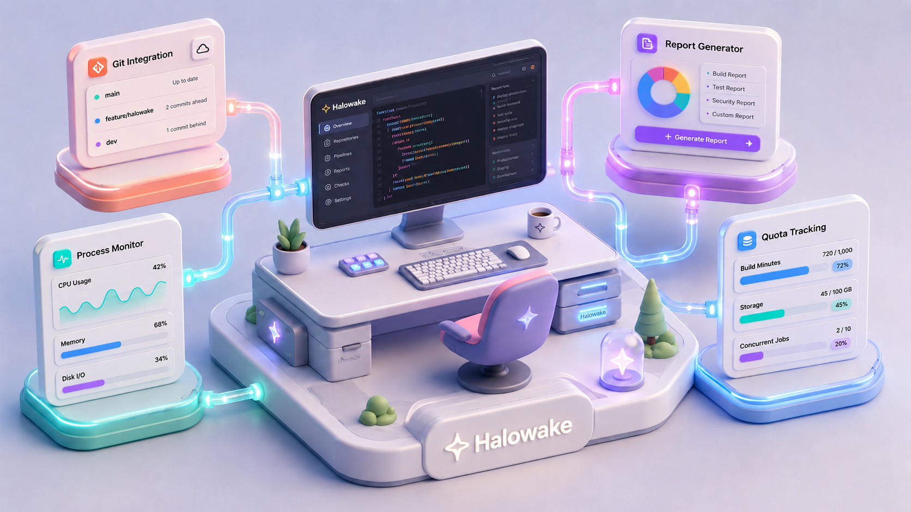
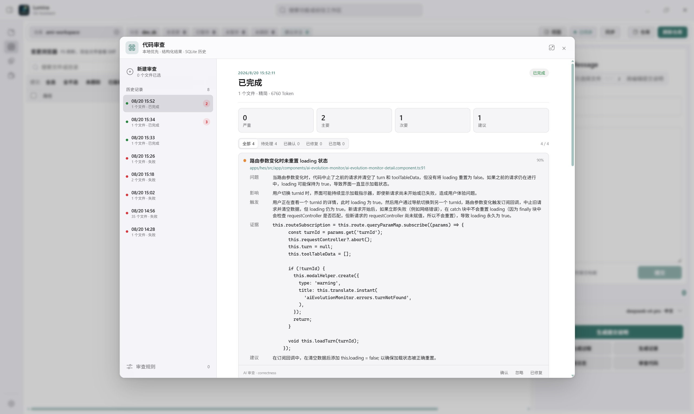

# Halowake

<p align="center">
  
</p>

<p align="center">
  <strong>AI Coding 时代的本地开发伴侣 · A Local-First Companion for AI Coding Workflows</strong>
</p>

<p align="center">
  <b>简体中文</b> | <a href="./README.en.md"><b>English</b></a>
</p>

<p align="center">
  <a href="https://github.com/zhkai-ybwn/Halowake/releases/tag/v1.4.4"></a>
  <a href="https://v2.tauri.app/"></a>
  <a href="https://vuejs.org/"></a>
  <a href="https://www.typescriptlang.org/"></a>
  <a href="https://www.rust-lang.org/"></a>
  <a href="./LICENSE"></a>
  
</p>

<p align="center">
  <a href="https://github.com/zhkai-ybwn/Halowake/releases">下载最新安装包</a> ·
  <a href="#-核心功能矩阵">功能全景</a> ·
  <a href="#-安装与快速上手">快速上手</a> ·
  <a href="https://github.com/zhkai-ybwn/Halowake/issues/new/choose">反馈与建议</a>
</p>

---

## 📖 产品定位与设计原则

> **Codex, Claude Code & Antigravity write the code. Halowake handles everything around it.**

**Halowake** 不替代 Codex、Claude Code、OpenCode 或 Google Antigravity 等 AI Coding Agent，而是深度协同现代 AI 编程工作流，承接代码生成之外大量高频、重复的辅助开发工作：

- 🛡️ **本地优先与数据自治（Local-First & Zero Telemetry）**：所有配置、Git 提交历史、代码审查记录、会话解析与存储分析完全在本地运行，无任何隐式云端上报，数据不出本机设备。
- ⚡ **零 Token / 低成本消费（Zero Token & Cost-Efficient）**：工作日报生成采用 100% 磁盘本地 IO 解析（**0 Token 消耗**）；Git AI 提交与轻量代码审查采用高性价比模型（DeepSeek、Ollama、OpenAI Compatible），把昂贵的 Agent 核心额度留给高价值编码任务。
- 🔄 **全流程闭环协同（Workflow Closed-Loop）**：打通代码生成后的 Diff 审查、原子暂存提交、多项目开发服务运维、Agent 技能生态扩展与滚动配额定时唤醒，构成完整的 AI Coding 生产力闭环。

---

## 🌟 核心功能矩阵

```
┌────────────────────────────────────────────────────────────────────────┐
│                              HALOWAKE                                  │
├───────────────────┬───────────────────┬────────────────────────────────┤
│   🚀 Agent 生态   │   🚢 进程与服务   │   🔀 Git 与工作流              │
│  • 技能中心 2.0   │  • DevDock 看板   │  • Git Assistant AI 提交       │
│  • FTS5 混合检索  │  • 端口排查清理   │  • 原子暂存保护 (Atomic Stage) │
│  • Codex 配额预热 │  • 树级进程终止   │  • 本地代码审查 (Code Review)  │
├───────────────────┴───────────────────┴────────────────────────────────┤
│   📝 洞察与资产管理                                                   │
│  • 0 Token 日报生成 (Codex / Claude Code / Antigravity / OpenCode)     │
│  • AI Quota 算力节奏监控 (Pace Tracking: 5h / Daily)                   │
│  • Agent 存储空间分析与垃圾清理 (Cache Cleaner)                        │
│  • 独立 Markdown 文档工作台 (TOC / KaTeX / 高亮)                       │
└────────────────────────────────────────────────────────────────────────┘
```

---

### 1. 📦 Agent 技能中心 2.0 (Agent Skills Ecosystem & Store)

一站式探索、检索、安装与审计现代 Coding Agent 技能，全面兼容 **Codex**、**Claude Code**、**Google Antigravity** 与 **OpenCode**。

- **10,000+ 丰富生态技能目录**：汇聚全网优质开发者技能，涵盖代码审查、自动化测试、DevOps、架构重构、国际化等丰富品类。
- **FTS5 高精度混合检索（Strict P@1 达 88.5%）**：
  - 基于 SQLite FTS5 倒排索引与 BM25 加权排序算法；
  - 引入权威字段分层排序（Name > Title > Tags > Summary > Description），支持中英双语、开发者同义词映射与自然语言意图搜索；
- **安全安装与防覆盖保护**：
  - 安装向导自动解析技能依赖与声明目录；
  - 严格校验本地自定义修改与命名冲突，杜绝意外覆盖；
- **版本感知与生命周期审计**：
  - 自动检测已安装技能的新版本更新；
  - 支持安全一键卸载与完整的本地安装历史追溯。

<!-- 截图占位：技能中心主界面 -->


---

### 2. ⏰ Codex 配额定时预热调度中枢 (Codex Quota Scheduler & Warmup)

针对 Codex 订阅制的 **5 小时滚动重置窗口**机制，提供轻量、安全、完全自主可控的后台定时预热服务。

- **滚动配额自动激活**：在预设时间节点自动发起轻量探测，提前唤醒并开启新的 5 小时配额周期，避免工作时因未激活导致配额浪费。
- **灵活的调度配置**：
  - 默认工作日（周一至周五）`08:00`、`13:00`、`18:00` 自动预热；
  - 支持自定义预热时刻列表、生效星期、轮询检查间隔（30s ~ 300s）以及最大等待窗口（5 ~ 60 分钟）；
  - 提供即时单次执行（立即检查/预热）与一键暂停/恢复控制；
- **高安全沙箱环境**：
  - 每次预热均在独立创建的临时目录与干净工作空间中执行（严格隔离 `CODEX_HOME`）；
  - 采用官方 Codex app-server 协议握手，仅临时复制当前本地 ChatGPT 登录会话凭据，**绝不包含 refresh token、用户自定义配置、外部 MCP 工具或任何自动化 Hooks**；
- **防重调用与智能熔断**：
  - 单个调度节点严格限制最多 1 次预热请求，已落盘记录；已处于有效新周期时不重复消费；
  - 连续 5 次瞬态网络错误自动指数退避熔断，鉴权或协议异常立即终止当前节点；
  - 调度历史与执行状态存入本地 SQLite，**零凭据、零敏感信息留存**。

---

### 3. 🚢 DevDock —— 多项目本地服务与进程看板

专为多仓库、多技术栈协同打造的本地进程编排与运维中枢。

- **项目脚本智能发现**：自动扫描并汇总各项目 `package.json` scripts 以及 Python、Shell、PowerShell、Cmd 脚本，一键并发启动与管理。
- **跨平台子进程树精准终止（Tree Kill）**：
  - Windows 基于 Job Object 机制，类 Unix 采用独立进程组；
  - 强力终止父子衍生进程树，杜绝僵尸进程与后台端口泄漏；
- **端口嗅探与本地访问直达**：实时分析服务日志输出，自动识别监听端口与 `localhost` 访问地址，支持浏览器一键直达。
- **🔍 端口排查与占用清理中枢（Port Troubleshooter）**：
  - 深度排查指定端口的占用情况，精准定位宿主进程 PID 与名称；
  - 支持对异常占用端口的进程执行一键强力终结与释放；
- **统一日志监控视窗**：内置 ANSI 彩色日志高亮流、日志级别筛选、关键字快速搜索与历史日志回放。
- **置顶与个性化排序**：支持高频脚本一键 Pin 置顶，自定义多项目显示优先级。

<!-- 截图占位：DevDock 进程管理界面 -->


---

### 4. 🔀 Git Assistant —— AI 提交与原子暂存保护

在代码生成之后，优雅承接代码审查、暂存管理与结构化提交。

- **基于 Diff 语义生成 Conventional Commit**：直接分析选中文件或工作区真实 Diff，利用高性价比模型（DeepSeek、Ollama、OpenAI Compatible）生成符合 Conventional Commits 规范的提交信息。
- **🛡️ 选择性提交原子保护（Atomic Staging Protection）**：
  - 仅提交当前在界面中勾选的文件；
  - 提交完成后自动无损还原未勾选文件的暂存区（Index）状态，彻底杜绝误提交与上下文污染；
- **全功能 Git 视图**：
  - 文件变更树（按目录折叠 / 展开）；
  - 三级对比支持：Working Tree、Staged（暂存区）与 HEAD Diff 对比；
  - 冲突文件状态高亮标记；
  - 本地与远程分支列表、检出、合并与快速切换；
  - Git Log 提交历史回溯与版本 Diff 详情。

<!-- 截图占位：Git Assistant 界面 -->


---

### 5. 📝 AI Coding 会话历史与 0 Token 日报生成

自动扫描并聚合本地主流 AI Coding 工具的历史会话，打造属于开发者的本地代码档案库。

- **多平台 Agent 会话原生解析**：
  - 🔵 **Codex CLI**：自动解析 `~/.codex/sessions/` 本地 JSONL 记录；
  - 🟢 **Claude Code**：自动解析 `~/.claude/projects/` 会话记录；
  - 🟣 **Google Antigravity**：读取 `~/.gemini/antigravity/brain/` 轨迹与项目关联；
  - 🟠 **OpenCode**：读取本地会话与工作区变更；
- **⚡ 0 Token 磁盘 IO 极速解析**：纯本地高性能读取与结构化清洗，**不消耗任何外部 API Token**。
- **灵活的时间与项目筛选**：按时间范围（今天/昨天/最近7天/自定义）、工具来源、项目路径及关键字精准过滤。
- **一键生成工作报告**：内置 Morning Standup、每日总结、周报等结构化 Prompt 模板，一键复制格式化事实至 ChatGPT / Claude / Kimi 等网页端模型生成最终报告。

<!-- 截图占位：AI 工作记录与日报生成界面 -->


---

### 6. 📊 AI Quota Tracking —— 算力配额与消耗节奏监控

统一监控多平台 API 额度与健康状况，告别频繁断供与未知超额。

- **多服务商状态聚合**：支持监控 DeepSeek、Gemini (Google AI Studio / Pro)、OpenAI、Claude、OpenRouter、Cursor、ZCode、QCode 等账户的可用额度与重置时间。
- **📈 动态 Pace 节奏评估算法**：
  - 依据 5 小时滚动周期或每日配额重置周期，动态计算当前消耗速率；
  - 精确标记 `On Pace`（安全）或 `Over Pace`（超速预警），辅助开发者合理分配算力预算；
- **独立配额中心模态**：支持独立多账户配置、时区对齐与刷新间隔自定义。

<!-- 截图占位：AI Quota 配额看板 -->


---

### 7. 🛡️ Local Code Review —— 本地代码审查引擎

在提交或合入前，对变更代码进行确定性与语义性双重质量把关。

- **确定性规则库 + AI 语义诊断**：本地运行自定义规则校验（如命名、安全禁令），并结合大模型进行代码异味与架构分析。
- **多档预算模式**：提供 `Strict`（深度分析）、`Balanced`（平衡模式）与 `Fast`（快速扫描）多档预算，按需调用。
- **精确至源码行的缺陷分级**：自动将问题归类为 `Critical`、`Major`、`Minor` 与 `Suggestion`，直接附带修正建议。
- **离线 SQLite 持久化**：所有历史审查报告保存在本地 SQLite 数据库中，支持复盘与追踪。

<!-- 截图占位：Local Code Review 界面 -->


---

### 8. 🧹 Agent 存储空间分析与垃圾清理 (Agent Storage & Cache Cleaner)

长时间高频使用 AI Coding Agent 会在本地堆积大量缓存日志、会话历史与临时文件。

- **全 Agent 存储深度扫描**：扫描 Antigravity、Codex、Claude Code 等工具产生的本地磁盘占用；
- **目录占用可视化**：直观展示各类日志、中间工作区与缓存目录的文件大小分布；
- **智能安全清理**：一键安全清理过期的临时文件与大体积会话，轻松释放数 GB 宝贵磁盘空间。

---

### 9. 📄 Markdown 独立阅读与文档工作台 (Markdown Preview)

- **独立多窗口渲染**：支持在独立窗口中打开并阅读 Markdown 文件，完全不干扰主工作区。
- **GitHub Flavored 完整语法**：支持表格、任务列表、警报块（Callouts）、代码块语法高亮与 KaTeX 数学公式渲染。
- **交互式大纲导航**：自动提取文档标题生成交互式目录（TOC），点击平滑跳转。

---

### 10. 🎨 现代桌面交互与统一设计体系 (Modern Desktop UI)

- **遵循 macOS / 现代桌面设计美学**：精心调校的设计 Token、微质感边框、层级阴影与平滑过渡动效。
- **原生深浅色主题自适应**：深浅色主题切换自适应，保持护眼且高对比度的阅读体验。
- **统一工作台组件体系**：统一的模态对话框、抽屉（Drawer）、Sheet 与关闭控制（WorkbenchCloseButton），杜绝样式碎片化。

---

## 🛠️ 技术栈与架构 (Tech Stack & Architecture)

```
┌────────────────────────────────────────────────────────┐
│                   Frontend (UI Layer)                  │
│       Vue 3.5  •  TypeScript  •  Vite  •  Naive UI     │
│        Pinia State  •  Vue-Router  •  Vue-I18n         │
└───────────────────────────┬────────────────────────────┘
                            │  Tauri IPC (Async Commands)
┌───────────────────────────┴────────────────────────────┐
│                   Backend (Rust Core)                  │
│     Tauri v2  •  Tokio Async Runtime  •  Rusqlite      │
│   SQLite (FTS5 / WAL)  •  Chrono  •  Reqwest  •  Ring  │
│  Job Object (Win) / Process Group (Unix)  •  ANSI Dec  │
└────────────────────────────────────────────────────────┘
```

- **前端架构**：采用 Vue 3.5 组合式 API + TypeScript 严格类型模式，配合 Naive UI 与深度定制的 CSS 变量设计系统；
- **后端架构**：采用 Rust 1.77+ 与 Tauri v2，基于 Tokio 构建异步并发调度工作线程；
- **数据持久化**：内嵌 SQLite 3 引擎，开启 WAL 模式与 FTS5 倒排索引，保障高并发读写安全与亚毫秒级检索响应。

---

## 📥 安装与快速上手

### 方式一：下载桌面安装包 (推荐)

前往 [GitHub Releases](https://github.com/zhkai-ybwn/Halowake/releases) 下载最新发行版：

- **Windows**:
  - `Halowake_x.x.x_x64-setup.exe`（官方标准安装包，支持自动升级）
  - `Halowake.exe`（便携免安装执行程序）
- **macOS**: `.dmg`（支持 Apple Silicon 与 Intel 架构）
- **Linux**: `.deb` / `.AppImage`

### 方式二：从源码编译构建

#### 环境准备
- [Node.js](https://nodejs.org/) (>= 20.0.0)
- [Rust & Cargo](https://www.rust-lang.org/) (>= 1.77.2)
- Git
- 操作系统对应的 [Tauri 2 构建先决条件](https://v2.tauri.app/start/prerequisites/)

#### 构建步骤

```bash
# 1. 克隆代码仓库
git clone https://github.com/zhkai-ybwn/Halowake.git
cd Halowake

# 2. 安装前端依赖
npm install

# 3. 启动本地开发与实时调试
npm run tauri:dev

# 4. 构建发布安装包
npm run tauri:build
```

编译生成的文件将存放在 `src-tauri/target/release/bundle/` 目录下。

---

## 🔒 隐私安全与本地自治原则

1. **零数据外发**：所有项目脚本执行、Git 操作、审查历史、会话扫描均在本地执行，绝不向任何私有云服务器上传数据。
2. **凭据本地加密存储**：API Key 仅保存在本地 SQLite 数据库或本地安全配置中，仅在用户显式触发请求时直连目标服务商（如 DeepSeek、OpenAI、Google 等），不经过任何第三方代理。
3. **安全操作边界**：DevDock 严格限制在用户主动添加的项目目录内执行指令；Codex 预热严格运行在干净临时的沙箱目录中。

---

## 🤝 参与贡献与社区支持

欢迎参与 Halowake 的共建！无论是提出想法、反馈缺陷还是提交代码合并请求：

- 🐛 **提交 Bug 报告**：[GitHub Issues](https://github.com/zhkai-ybwn/Halowake/issues/new/choose)
- 💡 **提交新功能想法**：[Feature Request](https://github.com/zhkai-ybwn/Halowake/issues/new/choose)
- 💬 **代码贡献与 Pull Request**：请查阅 [CONTRIBUTING.md](CONTRIBUTING.md) 了解开发规范与工作流。

---

## 📄 开源协议

本项目基于 [MIT License](LICENSE) 开源。
